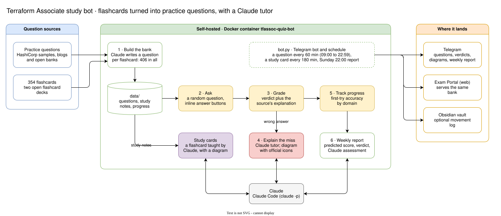

# Terraform Associate — Portable

A self-hosted Telegram study bot for the **HashiCorp Terraform Associate (004)** exam: practice questions graded with inline buttons, study cards made from flashcards, a Claude tutor that draws a diagram when you get one wrong, and a web front end through [Exam Portal](https://github.com/gcjk768/exam-portal).

> Unofficial and independent. Not affiliated with HashiCorp. The questions are community-written practice items, not exam content.

## Architecture

## Setup

Same as the [SAP-C03 bot](https://github.com/gcjk768/aws-certified-solutions-architect-professional-portable): BotFather token in `bot.env`, `python -I build_csv.py`, `python test_bot.py`, then `docker compose up -d --build` or `.\run.ps1`. See `CHANGELOG.md` for the question sources.

## License

MIT for the code.
